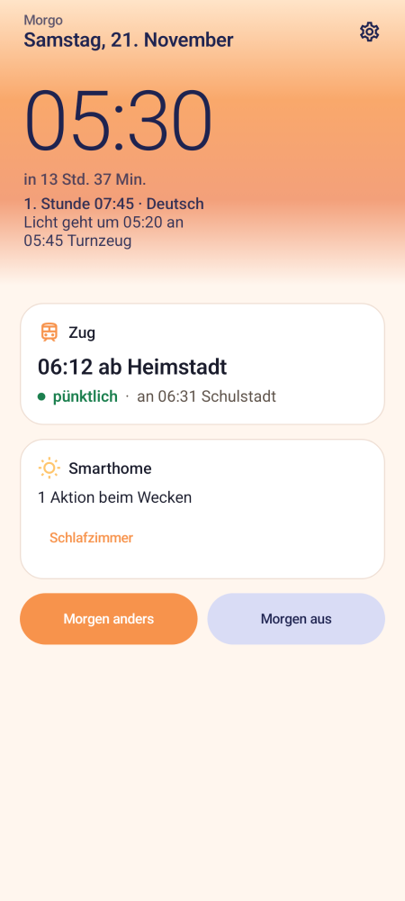
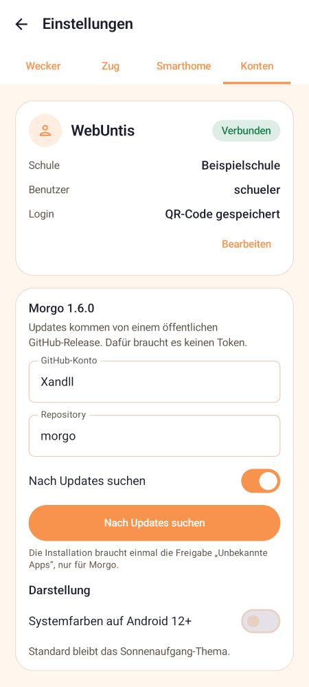
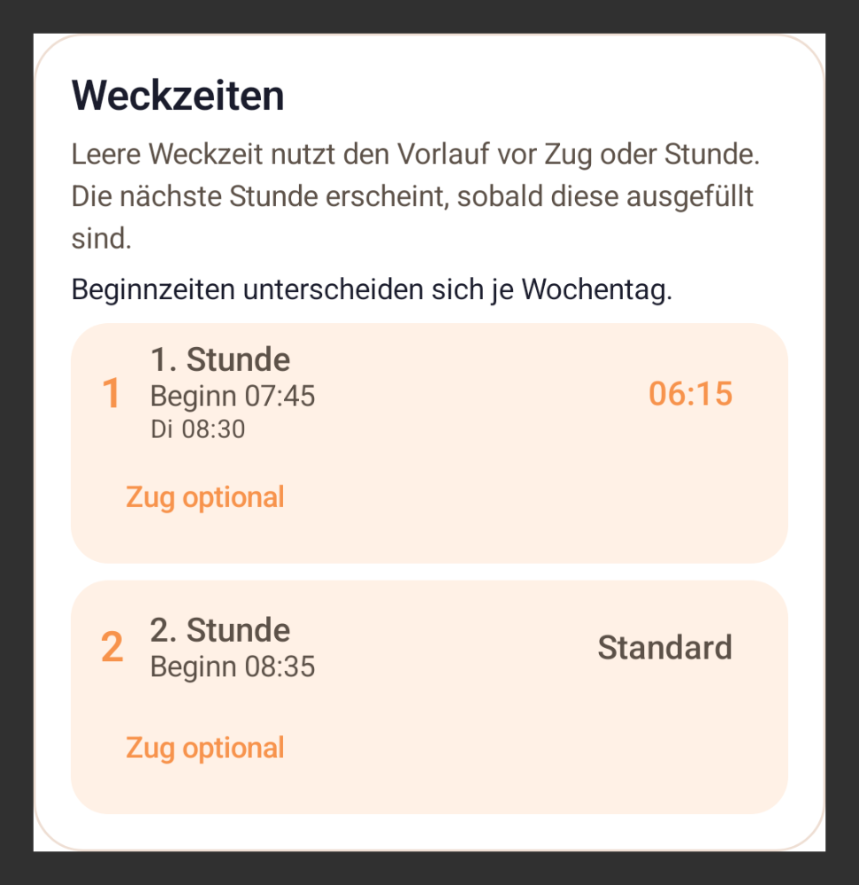
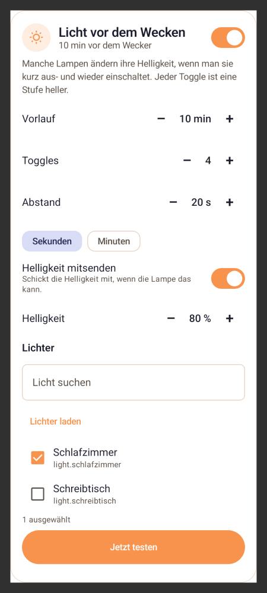

# Morgo

Wecker für den Schultag. Morgo rechnet die Weckzeit aus Stundenplan, Zug und Vorbereitungszeit und kann vorher das Licht einschalten.

Die Beispiele in der App und in den Screenshots sind erfunden: Schule „Beispielschule“, Benutzer „schueler“, Bahnhöfe „Heimstadt“ und „Schulstadt“.

## Oberfläche



Stundenplan über WebUntis, Zug über die ÖBB, Licht und Szenen über Home Assistant. Zugangsdaten bleiben auf dem Gerät, verschlüsselt.



Eine Weckzeit-Tabelle gilt für alle Tage. Weicht ein Beginn ab, steht das klein darunter.





## Lokal bauen

JDK 17 und Android SDK 35.

```bash
./gradlew testDebugUnitTest assembleDebug
```

Die Release-APK wird nur signiert, wenn der Keystore außerhalb des Repos liegt. In `local.properties` (nicht committen):

```
morgo.keystore=/pfad/zur/morgo-release.jks
morgo.keystore.properties=/pfad/zur/keystore.properties
```

Die Properties-Datei enthält `storePassword`, `keyPassword` und `keyAlias`. Alternativ setzen die Umgebungsvariablen `MORGO_KEYSTORE_FILE`, `MORGO_KEYSTORE_PASSWORD`, `MORGO_KEY_ALIAS` und `MORGO_KEY_PASSWORD` dieselben Werte.

Ab 1.6.0 hat die App ein eigenes Zertifikat. Eine ältere Installation muss einmal deinstalliert werden.

## Updates

Die App liest `https://api.github.com/repos/{owner}/{repo}/releases/latest`, Standard `Xandll/morgo`. Das lässt sich unter Konten ändern und abschalten. Ein neueres Tag `vX.Y.Z` erscheint als Hinweis und Benachrichtigung. Die APK kommt über den DownloadManager, optional mit der Datei `morgo-release.apk.sha256`. Installiert wird nur, wenn die Signatur zur installierten App passt. Android fragt dafür einmal nach der Freigabe „Unbekannte Apps“.

## Release veröffentlichen

Im GitHub-Repo diese Secrets anlegen, nie im Quelltext:

| Secret | Inhalt |
| --- | --- |
| `MORGO_KEYSTORE_B64` | Keystore, Base64 in einer Zeile |
| `MORGO_KEYSTORE_PASSWORD` | Store-Passwort |
| `MORGO_KEY_ALIAS` | Schlüsselalias |
| `MORGO_KEY_PASSWORD` | Schlüsselpasswort |

```bash
base64 -w 0 morgo-release.jks
```

Tag pushen, zum Beispiel `v1.6.0`. Der Workflow testet, signiert, legt `morgo-release.apk` und `morgo-release.apk.sha256` ins GitHub Release und schreibt den Changelog aus den Commits seit dem vorigen Tag. Debug-CI behält Artefakte drei Tage. Ein zweiter Workflow räumt montags Läufe, Artefakte und Caches älter als sieben Tage auf und behält nur die fünf neuesten Releases samt Tags.
